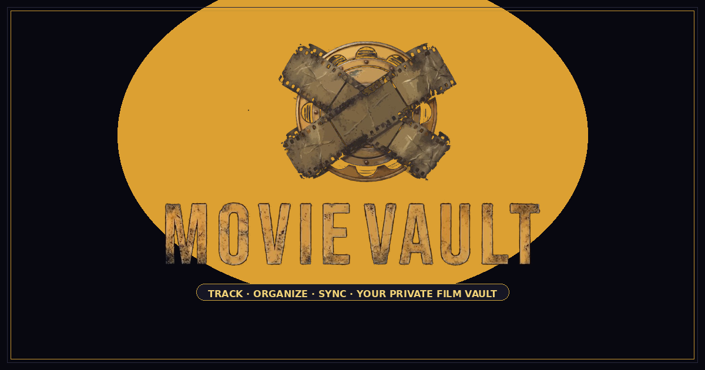

<div align="center">

<!-- Hero Banner -->


<br/><br/>

**Your personal, private film collection — built with taste.**

**[Live Demo](https://movie-vault-rho.vercel.app/)**

<br/>


</div>

---

## What is this?

Movie Vault is a **personal film collection app** — search any movie from IMDb's full database, save it to your vault, tag it, write notes, and mark it watched. Your collection syncs across every device you own, and only you can see it.

No algorithms. No recommendations. No social features. Just your movies, organised exactly how you want them.

---

## Features

<table>
<tr>
<td width="50%">

### 🎬 &nbsp;Search IMDb
Full OMDB-powered search with live results as you type. Posters, ratings, cast, director, plot, box office — everything loads instantly.

</td>
<td width="50%">

### 🏷️ &nbsp;Tag anything
Create your own tagging system. `rewatch`, `dad's pick`, `festival`, `guilty pleasure` — whatever makes sense to you.

</td>
</tr>
<tr>
<td width="50%">

### 📝 &nbsp;Personal notes
Write where you watched it, who you watched it with, your thoughts. Private, per-movie notes synced to the cloud.

</td>
<td width="50%">

### 🔍 &nbsp;Filter & sort
Filter by genre, language, your own tags, or watched status. Sort by title, year, IMDb rating, or date added.

</td>
</tr>
<tr>
<td width="50%">

### ⊞ &nbsp;Grid & list views
Switch between a cinematic poster grid and a compact list view — whichever fits how you're browsing.

</td>
<td width="50%">

### 🔒 &nbsp;Fully private
Row Level Security via Supabase. Your vault is completely invisible to other users — enforced at the database level.

</td>
</tr>
</table>

---

## Tech stack

```
Frontend        Vanilla HTML/CSS/JS — zero framework overhead
Auth + DB       Supabase (PostgreSQL + Auth)
Movie data      OMDB API (IMDb data)
Deployment      Vercel (serverless functions + static hosting)
Security        API keys stored as Vercel env vars, served via /api/config
```

No build step. No bundler. No dependencies to maintain. Open `public/index.html` and it's the whole app.

---

## Architecture

```
┌─────────────────────────────────────────────┐
│                  Browser                    │
│                                             │
│   public/index.html  ──fetch──▶  /api/config │
│       │                   (Vercel fn)        │
│       │                       │             │
│       │              reads env vars         │
│       │              SUPABASE_URL           │
│       │              SUPABASE_ANON_KEY      │
│       │              OMDB_API_KEY           │
│       │                       │             │
│       ◀───────── config JSON ─┘             │
│       │                                     │
│       ├──▶  Supabase  (auth + movies db)    │
│       └──▶  OMDB API  (search + details)    │
└─────────────────────────────────────────────┘
```

Keys are never in the source code. The HTML just calls `/api/config` — a serverless function reads from Vercel's environment and responds. Anyone who views your repo source sees nothing sensitive.


<div align="center">

Built with vanilla JS, no frameworks, no nonsense.

</div>
